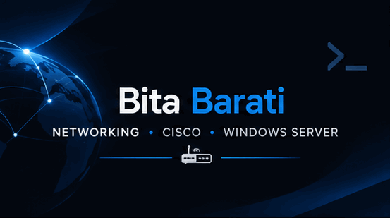

---

# Bita Barati

### NETWORKING • CISCO • WINDOWS SERVER

**IT Infrastructure & Network Enthusiast**

Learning. Practicing. Building.

  ────────── · ──────────

## 👋 About Me

I'm a university student passionate about **Networking, Cisco Technologies, Windows Server, and IT Infrastructure.**

I use GitHub to document my learning journey, organize technical knowledge, and share practical labs and projects.

My goal is to develop strong technical skills in network engineering and IT infrastructure through continuous learning and hands-on experience.

  ────────── · ──────────

## 🛠️ Technical Skills

### Networking & Cisco

### Operating Systems & Infrastructure

### Tools & Virtualization

  ────────── · ──────────

## 📂 Featured Projects

### 🔷 Cisco-CCNA
Cisco networking documentation and practical lab notes.

[Explore Repository →](https://github.com/BitaBarati/Cisco-CCNA)

### 🖥️ Windows-Server
Windows Server administration, Active Directory, DNS, and Group Policy labs.

[Explore Repository →](https://github.com/BitaBarati/Windows-Server)

### 🌐 Network-Plus
Networking fundamentals, IP addressing, subnetting, and VLSM.

[Explore Repository →](https://github.com/BitaBarati/Network-Plus)

  ────────── · ──────────

## 🎯 Currently Learning

- Cisco CCNA and networking technologies
- Cisco Packet Tracer labs and configurations
- Windows Server administration
- Active Directory and Group Policy
- Network infrastructure and virtualization

  ────────── · ──────────

## 💡 My Approach

### LEARN → PRACTICE → DOCUMENT → IMPROVE

I believe in continuous learning, practical experience, and documenting every step of my technical journey.

  ────────── · ──────────

## 🤝 Let's Connect

 

*Building knowledge. Strengthening skills. Growing through practice.*

